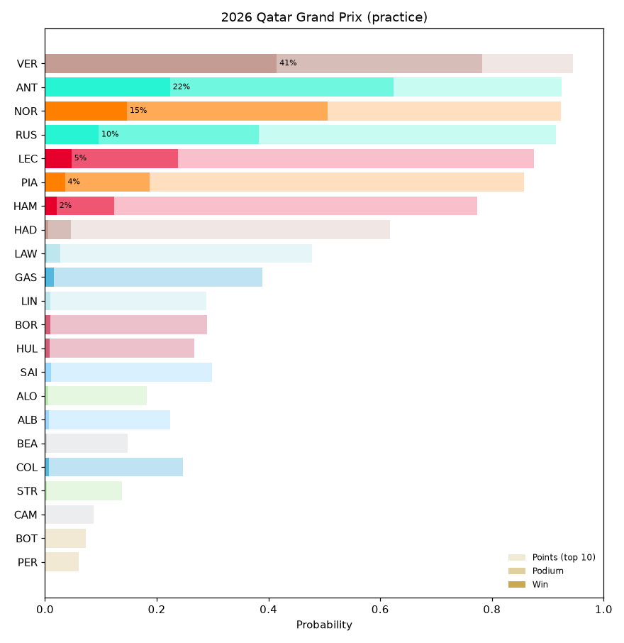

# 2026 Qatar Grand Prix — practice

Made 2026-11-28T04:17:10+00:00 (git fc7e051, config 9957757285d2, pitwall-f1 2.3.0.dev16). Race date 2026-11-29.

| # | Driver | Team | Win | Podium | Points | DNF | Exp. pos |
|---|---|---|---|---|---|---|---|
| 1 | VER | red-bull | 41.5% | 78.2% | 94.5% | 5.4% | 3.2 |
| 2 | ANT | mercedes | 22.4% | 62.4% | 92.4% | 7.5% | 4.3 |
| 3 | NOR | mclaren | 14.7% | 50.6% | 92.3% | 7.1% | 4.9 |
| 4 | RUS | mercedes | 9.6% | 38.3% | 91.4% | 6.8% | 5.6 |
| 5 | LEC | ferrari | 4.7% | 23.8% | 87.5% | 7.8% | 6.8 |
| 6 | PIA | mclaren | 3.6% | 18.7% | 85.7% | 7.6% | 7.3 |
| 7 | HAM | ferrari | 2.1% | 12.4% | 77.4% | 12.1% | 8.6 |
| 8 | HAD | red-bull | 0.6% | 4.6% | 61.7% | 9.5% | 10.4 |
| 9 | LAW | racing-bulls | 0.3% | 2.7% | 47.8% | 11.0% | 11.7 |
| 10 | GAS | alpine | 0.1% | 1.6% | 38.9% | 14.6% | 12.7 |
| 11 | LIN | racing-bulls | 0.1% | 1.0% | 28.9% | 14.7% | 13.5 |
| 12 | SAI | williams | 0.1% | 1.1% | 29.8% | 16.8% | 13.6 |
| 13 | BOR | audi | 0.1% | 0.9% | 29.0% | 19.1% | 13.7 |
| 14 | HUL | audi | 0.1% | 0.9% | 26.7% | 16.9% | 13.8 |
| 15 | COL | alpine | 0.0% | 0.7% | 24.7% | 17.0% | 14.0 |
| 16 | ALB | williams | 0.0% | 0.6% | 22.4% | 15.2% | 14.1 |
| 17 | BEA | haas | 0.0% | 0.3% | 14.8% | 17.9% | 15.0 |
| 18 | ALO | aston-martin | 0.0% | 0.5% | 18.2% | 35.6% | 15.6 |
| 19 | CAM | haas | 0.0% | 0.1% | 8.8% | 21.8% | 15.8 |
| 20 | BOT | cadillac | 0.0% | 0.1% | 7.3% | 20.3% | 15.9 |
| 21 | STR | aston-martin | 0.0% | 0.3% | 13.8% | 37.8% | 16.2 |
| 22 | PER | cadillac | 0.0% | 0.1% | 6.1% | 26.4% | 16.4 |

Data availability: has_openf1=1, has_practice_pace=1, has_forecast=1, has_track_temp=1, has_qualifying=0, topped_up_races=0

[All predictions](../index.md)
