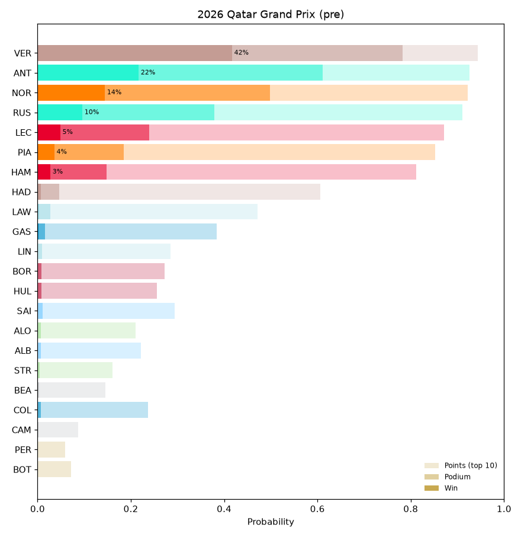

# 2026 Qatar Grand Prix — pre (phase16)

Made 2026-11-26T00:37:58+00:00 (git 09b91f8, config 9957757285d2, pitwall-f1 2.3.0.dev16). Race date 2026-11-29.

| # | Driver | Team | Win | Podium | Points | DNF | Exp. pos |
|---|---|---|---|---|---|---|---|
| 1 | VER | red-bull | 41.6% | 78.2% | 94.4% | 5.6% | 3.2 |
| 2 | ANT | mercedes | 21.6% | 61.1% | 92.6% | 7.3% | 4.4 |
| 3 | NOR | mclaren | 14.4% | 49.8% | 92.2% | 7.1% | 4.9 |
| 4 | RUS | mercedes | 9.6% | 37.9% | 91.1% | 7.0% | 5.7 |
| 5 | LEC | ferrari | 4.8% | 23.9% | 87.2% | 8.0% | 6.8 |
| 6 | PIA | mclaren | 3.6% | 18.5% | 85.2% | 7.7% | 7.3 |
| 7 | HAM | ferrari | 2.7% | 14.8% | 81.1% | 9.8% | 8.0 |
| 8 | HAD | red-bull | 0.7% | 4.6% | 60.6% | 10.1% | 10.5 |
| 9 | LAW | racing-bulls | 0.3% | 2.8% | 47.2% | 11.7% | 11.8 |
| 10 | GAS | alpine | 0.1% | 1.6% | 38.4% | 15.5% | 12.8 |
| 11 | LIN | racing-bulls | 0.1% | 1.0% | 28.5% | 15.6% | 13.6 |
| 12 | SAI | williams | 0.1% | 1.1% | 29.4% | 17.8% | 13.7 |
| 13 | BOR | audi | 0.1% | 0.9% | 27.3% | 17.2% | 13.8 |
| 14 | HUL | audi | 0.1% | 0.8% | 25.6% | 17.3% | 14.0 |
| 15 | COL | alpine | 0.0% | 0.7% | 23.7% | 17.0% | 14.1 |
| 16 | ALB | williams | 0.0% | 0.7% | 22.2% | 16.2% | 14.2 |
| 17 | ALO | aston-martin | 0.1% | 0.6% | 21.0% | 30.4% | 15.0 |
| 18 | BEA | haas | 0.0% | 0.3% | 14.6% | 18.9% | 15.1 |
| 19 | STR | aston-martin | 0.0% | 0.4% | 16.1% | 32.3% | 15.7 |
| 20 | CAM | haas | 0.0% | 0.1% | 8.7% | 22.8% | 15.9 |
| 21 | BOT | cadillac | 0.0% | 0.1% | 7.1% | 20.8% | 16.0 |
| 22 | PER | cadillac | 0.0% | 0.1% | 5.9% | 27.1% | 16.5 |

Data availability: has_openf1=0, has_practice_pace=0, has_forecast=1, has_track_temp=0, has_qualifying=0, topped_up_races=0

- ⚠ Entry list = the last race's starters (no session of this meeting has finished yet).
- Extra prediction 'phase16' with the pipeline above, made after this moment's first record; both are kept and graded.

[All predictions](../index.md)
