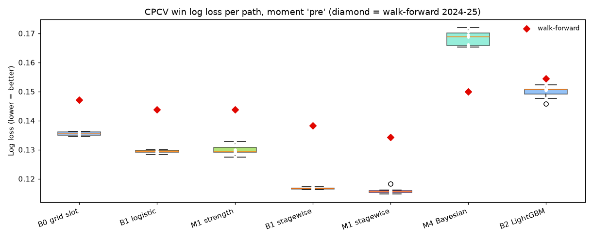
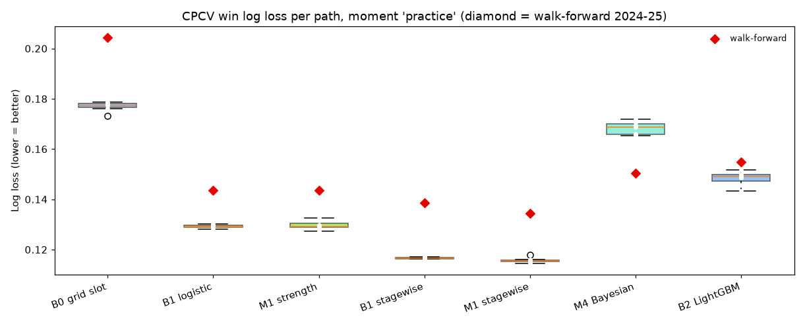
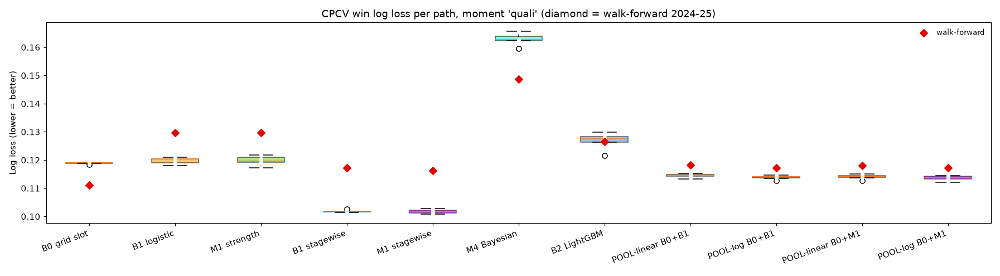
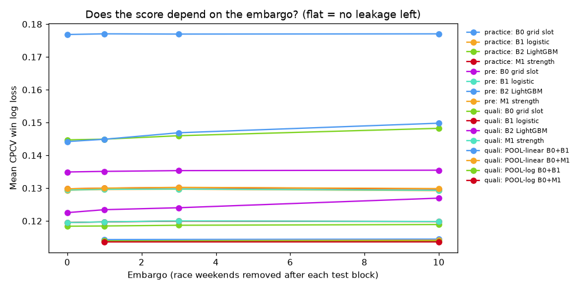

# pitwall validation (Phase 15)

Generated 2026-11-25 (git 57362bf). Data fingerprint(s): 068b0bc501f2, 1264e0ce8cbb, 40e791bea0de, 5ea64a7fcd96, 6f091d0bcf72, a96f44977aff. 2026 is never used.

- **Walk-forward** (primary, time-honest): every race of 2024-2025 predicted by models trained only on earlier races. The gate season is 2025.
- **CPCV** (robustness check): races 2018-2025 in 8 time blocks, every pair of blocks as test (28 splits), 10-race embargo after each test block, assembled into 7 full backtest paths. Log loss = binary log loss over driver rows.
- Lower log loss is better. P5 / P95 are interpolated from the 7 path scores.

## Moment: pre

| Model | WF win LL 2024-25 | WF win LL 2025 | CPCV win mean | win P5 | win median | win P95 | CPCV podium mean | podium P5 | podium median | podium P95 |
|---|---|---|---|---|---|---|---|---|---|---|
| B0 grid slot | 0.1472 | 0.1394 | 0.1355 | 0.1345 | 0.1355 | 0.1363 | 0.2916 | 0.2911 | 0.2915 | 0.2925 |
| B1 logistic | 0.1437 | 0.1415 | 0.1293 | 0.1285 | 0.1292 | 0.1302 | 0.2713 | 0.2693 | 0.2714 | 0.2734 |
| M1 strength | 0.1437 | 0.1410 | 0.1299 | 0.1278 | 0.1294 | 0.1324 | 0.2743 | 0.2696 | 0.2740 | 0.2797 |
| B1 stagewise | 0.1382 | 0.1330 | 0.1167 | 0.1163 | 0.1166 | 0.1172 | 0.2590 | 0.2579 | 0.2593 | 0.2599 |
| M1 stagewise | 0.1343 | 0.1272 | 0.1159 | 0.1149 | 0.1157 | 0.1176 | 0.2589 | 0.2563 | 0.2585 | 0.2624 |
| M4 Bayesian | 0.1500 | 0.1489 | 0.1682 | 0.1654 | 0.1687 | 0.1716 | 0.3531 | 0.3448 | 0.3521 | 0.3611 |
| B2 LightGBM | 0.1545 | 0.1518 | 0.1498 | 0.1463 | 0.1507 | 0.1519 | 0.3114 | 0.3067 | 0.3132 | 0.3140 |

## Moment: practice

| Model | WF win LL 2024-25 | WF win LL 2025 | CPCV win mean | win P5 | win median | win P95 | CPCV podium mean | podium P5 | podium median | podium P95 |
|---|---|---|---|---|---|---|---|---|---|---|
| B0 grid slot | 0.2043 | 0.2058 | 0.1770 | 0.1741 | 0.1775 | 0.1787 | 0.3669 | 0.3625 | 0.3669 | 0.3704 |
| B1 logistic | 0.1437 | 0.1413 | 0.1292 | 0.1283 | 0.1292 | 0.1301 | 0.2716 | 0.2695 | 0.2720 | 0.2736 |
| M1 strength | 0.1437 | 0.1408 | 0.1297 | 0.1277 | 0.1293 | 0.1323 | 0.2744 | 0.2696 | 0.2742 | 0.2799 |
| B1 stagewise | 0.1386 | 0.1327 | 0.1166 | 0.1162 | 0.1165 | 0.1171 | 0.2595 | 0.2583 | 0.2596 | 0.2606 |
| M1 stagewise | 0.1343 | 0.1266 | 0.1157 | 0.1146 | 0.1155 | 0.1174 | 0.2592 | 0.2563 | 0.2589 | 0.2627 |
| M4 Bayesian | 0.1503 | 0.1491 | 0.1683 | 0.1655 | 0.1687 | 0.1715 | 0.3532 | 0.3451 | 0.3521 | 0.3610 |
| B2 LightGBM | 0.1548 | 0.1522 | 0.1482 | 0.1440 | 0.1490 | 0.1512 | 0.3090 | 0.3041 | 0.3096 | 0.3134 |

## Moment: quali

| Model | WF win LL 2024-25 | WF win LL 2025 | CPCV win mean | win P5 | win median | win P95 | CPCV podium mean | podium P5 | podium median | podium P95 |
|---|---|---|---|---|---|---|---|---|---|---|
| B0 grid slot | 0.1111 | 0.0960 | 0.1189 | 0.1185 | 0.1190 | 0.1191 | 0.2395 | 0.2386 | 0.2397 | 0.2402 |
| B1 logistic | 0.1297 | 0.1234 | 0.1198 | 0.1183 | 0.1204 | 0.1209 | 0.2392 | 0.2368 | 0.2390 | 0.2411 |
| M1 strength | 0.1298 | 0.1233 | 0.1198 | 0.1177 | 0.1195 | 0.1217 | 0.2410 | 0.2368 | 0.2407 | 0.2447 |
| B1 stagewise | 0.1171 | 0.1004 | 0.1019 | 0.1015 | 0.1018 | 0.1024 | 0.2203 | 0.2190 | 0.2204 | 0.2213 |
| M1 stagewise | 0.1163 | 0.0993 | 0.1017 | 0.1010 | 0.1017 | 0.1026 | 0.2214 | 0.2195 | 0.2215 | 0.2227 |
| M4 Bayesian | 0.1487 | 0.1468 | 0.1629 | 0.1604 | 0.1627 | 0.1655 | 0.3394 | 0.3352 | 0.3401 | 0.3431 |
| B2 LightGBM | 0.1266 | 0.1142 | 0.1269 | 0.1230 | 0.1276 | 0.1296 | 0.2693 | 0.2635 | 0.2700 | 0.2741 |
| POOL-linear B0+B1 | 0.1181 | 0.1055 | 0.1145 | 0.1136 | 0.1144 | 0.1152 | 0.2322 | 0.2304 | 0.2323 | 0.2333 |
| POOL-log B0+B1 | 0.1173 | 0.1047 | 0.1138 | 0.1129 | 0.1140 | 0.1146 | 0.2300 | 0.2283 | 0.2301 | 0.2311 |
| POOL-linear B0+M1 | 0.1180 | 0.1054 | 0.1141 | 0.1130 | 0.1143 | 0.1149 | 0.2327 | 0.2299 | 0.2326 | 0.2349 |
| POOL-log B0+M1 | 0.1172 | 0.1046 | 0.1136 | 0.1124 | 0.1138 | 0.1144 | 0.2306 | 0.2279 | 0.2308 | 0.2327 |

## Embargo sensitivity (CPCV mean win log loss)

| Moment | Model | embargo 0 | embargo 1 | embargo 3 | embargo 10 | max - min |
|---|---|---|---|---|---|---|
| practice | B0 grid slot | 0.1768 | 0.1770 | 0.1770 | 0.1770 | 0.0002 |
| practice | B1 logistic | 0.1294 | 0.1296 | 0.1297 | 0.1292 | 0.0004 |
| practice | B2 LightGBM | 0.1447 | 0.1449 | 0.1460 | 0.1482 | 0.0035 |
| practice | M1 strength | 0.1298 | 0.1300 | 0.1302 | 0.1297 | 0.0004 |
| pre | B0 grid slot | 0.1349 | 0.1351 | 0.1353 | 0.1355 | 0.0005 |
| pre | B1 logistic | 0.1294 | 0.1297 | 0.1297 | 0.1293 | 0.0004 |
| pre | B2 LightGBM | 0.1442 | 0.1449 | 0.1469 | 0.1498 | 0.0056 |
| pre | M1 strength | 0.1298 | 0.1300 | 0.1302 | 0.1299 | 0.0004 |
| quali | B0 grid slot | 0.1184 | 0.1185 | 0.1187 | 0.1189 | 0.0005 |
| quali | B1 logistic | 0.1195 | 0.1197 | 0.1199 | 0.1198 | 0.0004 |
| quali | B2 LightGBM | 0.1225 | 0.1234 | 0.1240 | 0.1269 | 0.0044 |
| quali | M1 strength | 0.1195 | 0.1197 | 0.1200 | 0.1198 | 0.0005 |
| quali | POOL-linear B0+B1 | — | 0.1143 | — | 0.1145 | 0.0001 |
| quali | POOL-linear B0+M1 | — | 0.1139 | — | 0.1141 | 0.0002 |
| quali | POOL-log B0+B1 | — | 0.1139 | — | 0.1138 | 0.0001 |
| quali | POOL-log B0+M1 | — | 0.1136 | — | 0.1136 | 0.0000 |

Largest move: B2 LightGBM at 'pre', 0.0056 win LL (tolerance 0.002).
With embargo 0 the score is lower (looks better) than with embargo 10 for 9 of 12 model-moments: lower-with-less-embargo is the signature of leakage.
**Recommendation:** the scores move by more than 0.002, so use a larger default embargo (10 race weekends covers the 10-race rolling windows; championship points still carry a whole season, so no finite embargo removes everything).

## Gate decisions (gate_v2, against B0 grid slot)

Required: the 95% paired-bootstrap CI of (candidate - B0) on 2025 entirely below 0 for win AND podium log loss; the deflated p < 0.05 once the family has >= 10 trials; the median CPCV path better than B0's. Diebold-Mariano and the 3-race block bootstrap are context.

| Moment | Candidate | Trials | Gate |
|---|---|---|---|
| pre | B1 logistic | 1 | fail |
| pre | M1 strength | 2 | fail |
| pre | B1 stagewise | 3 | fail |
| pre | M1 stagewise | 3 | fail |
| pre | M4 Bayesian | 2 | fail |
| pre | B2 LightGBM | 1 | fail |
| practice | B1 logistic | 1 | PASS |
| practice | M1 strength | 2 | PASS |
| practice | B1 stagewise | 3 | PASS |
| practice | M1 stagewise | 3 | PASS |
| practice | M4 Bayesian | 2 | PASS |
| practice | B2 LightGBM | 1 | PASS |
| quali | POOL-linear B0+B1 | 12 | fail |
| quali | POOL-log B0+B1 | 12 | fail |
| quali | POOL-linear B0+M1 | 12 | fail |
| quali | POOL-log B0+M1 | 12 | fail |
| quali | B1 logistic | 1 | fail |
| quali | M1 strength | 2 | fail |
| quali | B1 stagewise | 3 | fail |
| quali | M1 stagewise | 3 | fail |
| quali | M4 Bayesian | 2 | fail |
| quali | B2 LightGBM | 1 | fail |

### Gate: B1 logistic vs B0 grid slot (pre)

| Check | Role | Result | Detail |
|---|---|---|---|
| win LL: 95% CI on 2025 entirely below 0 | required | fail | +0.0021 [-0.0088, +0.0132] over 24 races |
| podium LL: 95% CI on 2025 entirely below 0 | required | fail | +0.0038 [-0.0094, +0.0164] over 24 races |
| win LL: deflated p < 0.05 | context | fail | per-race score -0.076 over 24 races; the best of 1 useless tries would reach about +0.000 by luck; deflated p = 0.642 (required once >= 10 trials; now 1) |
| win LL: CPCV median path better | required | pass | median 0.1292 vs 0.1355; better on 7 of 7 paths |
| win LL: Diebold-Mariano (HLN) | context | fail | statistic +0.37, one-sided p = 0.643 (two-sided 0.714), 24 races |
| win LL: block bootstrap (3 races) | context | fail | +0.0021 [-0.0076, +0.0118] |

**Decision:** B1 logistic does NOT pass the gate against B0 grid slot at 'pre' (failed: win LL: 95% CI on 2025 entirely below 0; podium LL: 95% CI on 2025 entirely below 0). Keep the incumbent; move the candidate to lab/.

### Gate: M1 strength vs B0 grid slot (pre)

| Check | Role | Result | Detail |
|---|---|---|---|
| win LL: 95% CI on 2025 entirely below 0 | required | fail | +0.0016 [-0.0109, +0.0146] over 24 races |
| podium LL: 95% CI on 2025 entirely below 0 | required | fail | +0.0034 [-0.0131, +0.0183] over 24 races |
| win LL: deflated p < 0.05 | context | fail | per-race score -0.049 over 24 races; the best of 2 useless tries would reach about +0.108 by luck; deflated p = 0.777 (required once >= 10 trials; now 2) |
| win LL: CPCV median path better | required | pass | median 0.1294 vs 0.1355; better on 7 of 7 paths |
| win LL: Diebold-Mariano (HLN) | context | fail | statistic +0.24, one-sided p = 0.593 (two-sided 0.813), 24 races |
| win LL: block bootstrap (3 races) | context | fail | +0.0016 [-0.0095, +0.0124] |

**Decision:** M1 strength does NOT pass the gate against B0 grid slot at 'pre' (failed: win LL: 95% CI on 2025 entirely below 0; podium LL: 95% CI on 2025 entirely below 0). Keep the incumbent; move the candidate to lab/.

### Gate: B1 stagewise vs B0 grid slot (pre)

| Check | Role | Result | Detail |
|---|---|---|---|
| win LL: 95% CI on 2025 entirely below 0 | required | fail | -0.0063 [-0.0204, +0.0084] over 24 races |
| podium LL: 95% CI on 2025 entirely below 0 | required | fail | -0.0160 [-0.0316, +0.0005] over 24 races |
| win LL: deflated p < 0.05 | context | fail | per-race score +0.170 over 24 races; the best of 3 useless tries would reach about +0.178 by luck; deflated p = 0.514 (required once >= 10 trials; now 3) |
| win LL: CPCV median path better | required | pass | median 0.1166 vs 0.1355; better on 7 of 7 paths |
| win LL: Diebold-Mariano (HLN) | context | fail | statistic -0.84, one-sided p = 0.206 (two-sided 0.412), 24 races |
| win LL: block bootstrap (3 races) | context | fail | -0.0063 [-0.0188, +0.0080] |

**Decision:** B1 stagewise does NOT pass the gate against B0 grid slot at 'pre' (failed: win LL: 95% CI on 2025 entirely below 0; podium LL: 95% CI on 2025 entirely below 0). Keep the incumbent; move the candidate to lab/.

### Gate: M1 stagewise vs B0 grid slot (pre)

| Check | Role | Result | Detail |
|---|---|---|---|
| win LL: 95% CI on 2025 entirely below 0 | required | fail | -0.0122 [-0.0261, +0.0017] over 24 races |
| podium LL: 95% CI on 2025 entirely below 0 | required | pass | -0.0228 [-0.0360, -0.0093] over 24 races |
| win LL: deflated p < 0.05 | context | fail | per-race score +0.337 over 24 races; the best of 3 useless tries would reach about +0.178 by luck; deflated p = 0.231 (required once >= 10 trials; now 3) |
| win LL: CPCV median path better | required | pass | median 0.1157 vs 0.1355; better on 7 of 7 paths |
| win LL: Diebold-Mariano (HLN) | context | fail | statistic -1.65, one-sided p = 0.056 (two-sided 0.112), 24 races |
| win LL: block bootstrap (3 races) | context | pass | -0.0122 [-0.0227, -0.0021] |

**Decision:** M1 stagewise does NOT pass the gate against B0 grid slot at 'pre' (failed: win LL: 95% CI on 2025 entirely below 0). Keep the incumbent; move the candidate to lab/.

### Gate: M4 Bayesian vs B0 grid slot (pre)

| Check | Role | Result | Detail |
|---|---|---|---|
| win LL: 95% CI on 2025 entirely below 0 | required | fail | +0.0096 [-0.0046, +0.0245] over 24 races |
| podium LL: 95% CI on 2025 entirely below 0 | required | fail | +0.0268 [+0.0031, +0.0484] over 24 races |
| win LL: deflated p < 0.05 | context | fail | per-race score -0.254 over 24 races; the best of 2 useless tries would reach about +0.108 by luck; deflated p = 0.968 (required once >= 10 trials; now 2) |
| win LL: CPCV median path better | required | fail | median 0.1687 vs 0.1355; better on 0 of 7 paths |
| win LL: Diebold-Mariano (HLN) | context | fail | statistic +1.24, one-sided p = 0.887 (two-sided 0.226), 24 races |
| win LL: block bootstrap (3 races) | context | fail | +0.0096 [-0.0058, +0.0266] |

**Decision:** M4 Bayesian does NOT pass the gate against B0 grid slot at 'pre' (failed: win LL: 95% CI on 2025 entirely below 0; podium LL: 95% CI on 2025 entirely below 0; win LL: CPCV median path better). Keep the incumbent; move the candidate to lab/.

### Gate: B2 LightGBM vs B0 grid slot (pre)

| Check | Role | Result | Detail |
|---|---|---|---|
| win LL: 95% CI on 2025 entirely below 0 | required | fail | +0.0125 [-0.0018, +0.0272] over 24 races |
| podium LL: 95% CI on 2025 entirely below 0 | required | fail | +0.0400 [+0.0176, +0.0627] over 24 races |
| win LL: deflated p < 0.05 | context | fail | per-race score -0.329 over 24 races; the best of 1 useless tries would reach about +0.000 by luck; deflated p = 0.948 (required once >= 10 trials; now 1) |
| win LL: CPCV median path better | required | fail | median 0.1507 vs 0.1355; better on 0 of 7 paths |
| win LL: Diebold-Mariano (HLN) | context | fail | statistic +1.61, one-sided p = 0.940 (two-sided 0.120), 24 races |
| win LL: block bootstrap (3 races) | context | fail | +0.0125 [-0.0022, +0.0270] |

**Decision:** B2 LightGBM does NOT pass the gate against B0 grid slot at 'pre' (failed: win LL: 95% CI on 2025 entirely below 0; podium LL: 95% CI on 2025 entirely below 0; win LL: CPCV median path better). Keep the incumbent; move the candidate to lab/.

### Gate: B1 logistic vs B0 grid slot (practice)

| Check | Role | Result | Detail |
|---|---|---|---|
| win LL: 95% CI on 2025 entirely below 0 | required | pass | -0.0646 [-0.0889, -0.0389] over 24 races |
| podium LL: 95% CI on 2025 entirely below 0 | required | pass | -0.1436 [-0.1860, -0.1029] over 24 races |
| win LL: deflated p < 0.05 | context | pass | per-race score +1.009 over 24 races; the best of 1 useless tries would reach about +0.000 by luck; deflated p = 0.000 (required once >= 10 trials; now 1) |
| win LL: CPCV median path better | required | pass | median 0.1292 vs 0.1775; better on 7 of 7 paths |
| win LL: Diebold-Mariano (HLN) | context | pass | statistic -4.94, one-sided p = 0.000 (two-sided 0.000), 24 races |
| win LL: block bootstrap (3 races) | context | pass | -0.0646 [-0.0853, -0.0436] |

**Decision:** B1 logistic PASSES the gate against B0 grid slot at 'practice': every required check passed.

### Gate: M1 strength vs B0 grid slot (practice)

| Check | Role | Result | Detail |
|---|---|---|---|
| win LL: 95% CI on 2025 entirely below 0 | required | pass | -0.0651 [-0.0871, -0.0423] over 24 races |
| podium LL: 95% CI on 2025 entirely below 0 | required | pass | -0.1441 [-0.1824, -0.1064] over 24 races |
| win LL: deflated p < 0.05 | context | pass | per-race score +1.121 over 24 races; the best of 2 useless tries would reach about +0.108 by luck; deflated p = 0.000 (required once >= 10 trials; now 2) |
| win LL: CPCV median path better | required | pass | median 0.1293 vs 0.1775; better on 7 of 7 paths |
| win LL: Diebold-Mariano (HLN) | context | pass | statistic -5.49, one-sided p = 0.000 (two-sided 0.000), 24 races |
| win LL: block bootstrap (3 races) | context | pass | -0.0651 [-0.0843, -0.0457] |

**Decision:** M1 strength PASSES the gate against B0 grid slot at 'practice': every required check passed.

### Gate: B1 stagewise vs B0 grid slot (practice)

| Check | Role | Result | Detail |
|---|---|---|---|
| win LL: 95% CI on 2025 entirely below 0 | required | pass | -0.0732 [-0.1049, -0.0393] over 24 races |
| podium LL: 95% CI on 2025 entirely below 0 | required | pass | -0.1634 [-0.2120, -0.1145] over 24 races |
| win LL: deflated p < 0.05 | context | pass | per-race score +0.863 over 24 races; the best of 3 useless tries would reach about +0.178 by luck; deflated p = 0.008 (required once >= 10 trials; now 3) |
| win LL: CPCV median path better | required | pass | median 0.1165 vs 0.1775; better on 7 of 7 paths |
| win LL: Diebold-Mariano (HLN) | context | pass | statistic -4.23, one-sided p = 0.000 (two-sided 0.000), 24 races |
| win LL: block bootstrap (3 races) | context | pass | -0.0732 [-0.1002, -0.0450] |

**Decision:** B1 stagewise PASSES the gate against B0 grid slot at 'practice': every required check passed.

### Gate: M1 stagewise vs B0 grid slot (practice)

| Check | Role | Result | Detail |
|---|---|---|---|
| win LL: 95% CI on 2025 entirely below 0 | required | pass | -0.0792 [-0.1061, -0.0516] over 24 races |
| podium LL: 95% CI on 2025 entirely below 0 | required | pass | -0.1703 [-0.2132, -0.1274] over 24 races |
| win LL: deflated p < 0.05 | context | pass | per-race score +1.118 over 24 races; the best of 3 useless tries would reach about +0.178 by luck; deflated p = 0.000 (required once >= 10 trials; now 3) |
| win LL: CPCV median path better | required | pass | median 0.1155 vs 0.1775; better on 7 of 7 paths |
| win LL: Diebold-Mariano (HLN) | context | pass | statistic -5.48, one-sided p = 0.000 (two-sided 0.000), 24 races |
| win LL: block bootstrap (3 races) | context | pass | -0.0792 [-0.1024, -0.0555] |

**Decision:** M1 stagewise PASSES the gate against B0 grid slot at 'practice': every required check passed.

### Gate: M4 Bayesian vs B0 grid slot (practice)

| Check | Role | Result | Detail |
|---|---|---|---|
| win LL: 95% CI on 2025 entirely below 0 | required | pass | -0.0568 [-0.0772, -0.0354] over 24 races |
| podium LL: 95% CI on 2025 entirely below 0 | required | pass | -0.1203 [-0.1583, -0.0832] over 24 races |
| win LL: deflated p < 0.05 | context | pass | per-race score +1.040 over 24 races; the best of 2 useless tries would reach about +0.108 by luck; deflated p = 0.001 (required once >= 10 trials; now 2) |
| win LL: CPCV median path better | required | pass | median 0.1687 vs 0.1775; better on 7 of 7 paths |
| win LL: Diebold-Mariano (HLN) | context | pass | statistic -5.09, one-sided p = 0.000 (two-sided 0.000), 24 races |
| win LL: block bootstrap (3 races) | context | pass | -0.0568 [-0.0737, -0.0411] |

**Decision:** M4 Bayesian PASSES the gate against B0 grid slot at 'practice': every required check passed.

### Gate: B2 LightGBM vs B0 grid slot (practice)

| Check | Role | Result | Detail |
|---|---|---|---|
| win LL: 95% CI on 2025 entirely below 0 | required | pass | -0.0536 [-0.0766, -0.0294] over 24 races |
| podium LL: 95% CI on 2025 entirely below 0 | required | pass | -0.1153 [-0.1560, -0.0758] over 24 races |
| win LL: deflated p < 0.05 | context | pass | per-race score +0.888 over 24 races; the best of 1 useless tries would reach about +0.000 by luck; deflated p = 0.001 (required once >= 10 trials; now 1) |
| win LL: CPCV median path better | required | pass | median 0.1490 vs 0.1775; better on 7 of 7 paths |
| win LL: Diebold-Mariano (HLN) | context | pass | statistic -4.35, one-sided p = 0.000 (two-sided 0.000), 24 races |
| win LL: block bootstrap (3 races) | context | pass | -0.0536 [-0.0713, -0.0344] |

**Decision:** B2 LightGBM PASSES the gate against B0 grid slot at 'practice': every required check passed.

### Gate: POOL-linear B0+B1 vs B0 grid slot (quali)

| Check | Role | Result | Detail |
|---|---|---|---|
| win LL: 95% CI on 2025 entirely below 0 | required | fail | +0.0095 [+0.0004, +0.0181] over 24 races |
| podium LL: 95% CI on 2025 entirely below 0 | required | fail | +0.0071 [-0.0046, +0.0195] over 24 races |
| win LL: deflated p < 0.05 | required | fail | per-race score -0.415 over 24 races; the best of 12 useless tries would reach about +0.347 by luck; deflated p = 0.999 |
| win LL: CPCV median path better | required | pass | median 0.1144 vs 0.1190; better on 7 of 7 paths |
| win LL: Diebold-Mariano (HLN) | context | fail | statistic +2.03, one-sided p = 0.973 (two-sided 0.054), 24 races |
| win LL: block bootstrap (3 races) | context | fail | +0.0095 [-0.0013, +0.0196] |

**Decision:** POOL-linear B0+B1 does NOT pass the gate against B0 grid slot at 'quali' (failed: win LL: 95% CI on 2025 entirely below 0; podium LL: 95% CI on 2025 entirely below 0; win LL: deflated p < 0.05). Keep the incumbent; move the candidate to lab/.

### Gate: POOL-log B0+B1 vs B0 grid slot (quali)

| Check | Role | Result | Detail |
|---|---|---|---|
| win LL: 95% CI on 2025 entirely below 0 | required | fail | +0.0088 [+0.0000, +0.0174] over 24 races |
| podium LL: 95% CI on 2025 entirely below 0 | required | fail | +0.0038 [-0.0070, +0.0151] over 24 races |
| win LL: deflated p < 0.05 | required | fail | per-race score -0.390 over 24 races; the best of 12 useless tries would reach about +0.347 by luck; deflated p = 0.999 |
| win LL: CPCV median path better | required | pass | median 0.1140 vs 0.1190; better on 7 of 7 paths |
| win LL: Diebold-Mariano (HLN) | context | fail | statistic +1.91, one-sided p = 0.966 (two-sided 0.069), 24 races |
| win LL: block bootstrap (3 races) | context | fail | +0.0088 [-0.0019, +0.0189] |

**Decision:** POOL-log B0+B1 does NOT pass the gate against B0 grid slot at 'quali' (failed: win LL: 95% CI on 2025 entirely below 0; podium LL: 95% CI on 2025 entirely below 0; win LL: deflated p < 0.05). Keep the incumbent; move the candidate to lab/.

### Gate: POOL-linear B0+M1 vs B0 grid slot (quali)

| Check | Role | Result | Detail |
|---|---|---|---|
| win LL: 95% CI on 2025 entirely below 0 | required | fail | +0.0095 [+0.0008, +0.0176] over 24 races |
| podium LL: 95% CI on 2025 entirely below 0 | required | fail | +0.0068 [-0.0046, +0.0185] over 24 races |
| win LL: deflated p < 0.05 | required | fail | per-race score -0.433 over 24 races; the best of 12 useless tries would reach about +0.347 by luck; deflated p = 0.999 |
| win LL: CPCV median path better | required | pass | median 0.1143 vs 0.1190; better on 7 of 7 paths |
| win LL: Diebold-Mariano (HLN) | context | fail | statistic +2.12, one-sided p = 0.978 (two-sided 0.045), 24 races |
| win LL: block bootstrap (3 races) | context | fail | +0.0095 [-0.0007, +0.0189] |

**Decision:** POOL-linear B0+M1 does NOT pass the gate against B0 grid slot at 'quali' (failed: win LL: 95% CI on 2025 entirely below 0; podium LL: 95% CI on 2025 entirely below 0; win LL: deflated p < 0.05). Keep the incumbent; move the candidate to lab/.

### Gate: POOL-log B0+M1 vs B0 grid slot (quali)

| Check | Role | Result | Detail |
|---|---|---|---|
| win LL: 95% CI on 2025 entirely below 0 | required | fail | +0.0086 [+0.0001, +0.0168] over 24 races |
| podium LL: 95% CI on 2025 entirely below 0 | required | fail | +0.0035 [-0.0069, +0.0143] over 24 races |
| win LL: deflated p < 0.05 | required | fail | per-race score -0.397 over 24 races; the best of 12 useless tries would reach about +0.347 by luck; deflated p = 0.999 |
| win LL: CPCV median path better | required | pass | median 0.1138 vs 0.1190; better on 7 of 7 paths |
| win LL: Diebold-Mariano (HLN) | context | fail | statistic +1.95, one-sided p = 0.968 (two-sided 0.064), 24 races |
| win LL: block bootstrap (3 races) | context | fail | +0.0086 [-0.0015, +0.0182] |

**Decision:** POOL-log B0+M1 does NOT pass the gate against B0 grid slot at 'quali' (failed: win LL: 95% CI on 2025 entirely below 0; podium LL: 95% CI on 2025 entirely below 0; win LL: deflated p < 0.05). Keep the incumbent; move the candidate to lab/.

### Gate: B1 logistic vs B0 grid slot (quali)

| Check | Role | Result | Detail |
|---|---|---|---|
| win LL: 95% CI on 2025 entirely below 0 | required | fail | +0.0274 [+0.0092, +0.0456] over 24 races |
| podium LL: 95% CI on 2025 entirely below 0 | required | fail | +0.0255 [+0.0028, +0.0491] over 24 races |
| win LL: deflated p < 0.05 | context | fail | per-race score -0.579 over 24 races; the best of 1 useless tries would reach about +0.000 by luck; deflated p = 0.988 (required once >= 10 trials; now 1) |
| win LL: CPCV median path better | required | fail | median 0.1204 vs 0.1190; better on 2 of 7 paths |
| win LL: Diebold-Mariano (HLN) | context | fail | statistic +2.84, one-sided p = 0.995 (two-sided 0.009), 24 races |
| win LL: block bootstrap (3 races) | context | fail | +0.0274 [+0.0048, +0.0490] |

**Decision:** B1 logistic does NOT pass the gate against B0 grid slot at 'quali' (failed: win LL: 95% CI on 2025 entirely below 0; podium LL: 95% CI on 2025 entirely below 0; win LL: CPCV median path better). Keep the incumbent; move the candidate to lab/.

### Gate: M1 strength vs B0 grid slot (quali)

| Check | Role | Result | Detail |
|---|---|---|---|
| win LL: 95% CI on 2025 entirely below 0 | required | fail | +0.0274 [+0.0095, +0.0447] over 24 races |
| podium LL: 95% CI on 2025 entirely below 0 | required | fail | +0.0253 [+0.0035, +0.0475] over 24 races |
| win LL: deflated p < 0.05 | context | fail | per-race score -0.596 over 24 races; the best of 2 useless tries would reach about +0.108 by luck; deflated p = 0.997 (required once >= 10 trials; now 2) |
| win LL: CPCV median path better | required | fail | median 0.1195 vs 0.1190; better on 2 of 7 paths |
| win LL: Diebold-Mariano (HLN) | context | fail | statistic +2.92, one-sided p = 0.996 (two-sided 0.008), 24 races |
| win LL: block bootstrap (3 races) | context | fail | +0.0274 [+0.0057, +0.0476] |

**Decision:** M1 strength does NOT pass the gate against B0 grid slot at 'quali' (failed: win LL: 95% CI on 2025 entirely below 0; podium LL: 95% CI on 2025 entirely below 0; win LL: CPCV median path better). Keep the incumbent; move the candidate to lab/.

### Gate: B1 stagewise vs B0 grid slot (quali)

| Check | Role | Result | Detail |
|---|---|---|---|
| win LL: 95% CI on 2025 entirely below 0 | required | fail | +0.0045 [-0.0159, +0.0258] over 24 races |
| podium LL: 95% CI on 2025 entirely below 0 | required | fail | -0.0018 [-0.0277, +0.0268] over 24 races |
| win LL: deflated p < 0.05 | context | fail | per-race score -0.083 over 24 races; the best of 3 useless tries would reach about +0.178 by luck; deflated p = 0.895 (required once >= 10 trials; now 3) |
| win LL: CPCV median path better | required | pass | median 0.1018 vs 0.1190; better on 7 of 7 paths |
| win LL: Diebold-Mariano (HLN) | context | fail | statistic +0.41, one-sided p = 0.655 (two-sided 0.689), 24 races |
| win LL: block bootstrap (3 races) | context | fail | +0.0045 [-0.0195, +0.0267] |

**Decision:** B1 stagewise does NOT pass the gate against B0 grid slot at 'quali' (failed: win LL: 95% CI on 2025 entirely below 0; podium LL: 95% CI on 2025 entirely below 0). Keep the incumbent; move the candidate to lab/.

### Gate: M1 stagewise vs B0 grid slot (quali)

| Check | Role | Result | Detail |
|---|---|---|---|
| win LL: 95% CI on 2025 entirely below 0 | required | fail | +0.0034 [-0.0162, +0.0235] over 24 races |
| podium LL: 95% CI on 2025 entirely below 0 | required | fail | -0.0030 [-0.0269, +0.0230] over 24 races |
| win LL: deflated p < 0.05 | context | fail | per-race score -0.065 over 24 races; the best of 3 useless tries would reach about +0.178 by luck; deflated p = 0.876 (required once >= 10 trials; now 3) |
| win LL: CPCV median path better | required | pass | median 0.1017 vs 0.1190; better on 7 of 7 paths |
| win LL: Diebold-Mariano (HLN) | context | fail | statistic +0.32, one-sided p = 0.623 (two-sided 0.754), 24 races |
| win LL: block bootstrap (3 races) | context | fail | +0.0034 [-0.0199, +0.0244] |

**Decision:** M1 stagewise does NOT pass the gate against B0 grid slot at 'quali' (failed: win LL: 95% CI on 2025 entirely below 0; podium LL: 95% CI on 2025 entirely below 0). Keep the incumbent; move the candidate to lab/.

### Gate: M4 Bayesian vs B0 grid slot (quali)

| Check | Role | Result | Detail |
|---|---|---|---|
| win LL: 95% CI on 2025 entirely below 0 | required | fail | +0.0508 [+0.0300, +0.0702] over 24 races |
| podium LL: 95% CI on 2025 entirely below 0 | required | fail | +0.0774 [+0.0460, +0.1073] over 24 races |
| win LL: deflated p < 0.05 | context | fail | per-race score -0.977 over 24 races; the best of 2 useless tries would reach about +0.108 by luck; deflated p = 1.000 (required once >= 10 trials; now 2) |
| win LL: CPCV median path better | required | fail | median 0.1627 vs 0.1190; better on 0 of 7 paths |
| win LL: Diebold-Mariano (HLN) | context | fail | statistic +4.79, one-sided p = 1.000 (two-sided 0.000), 24 races |
| win LL: block bootstrap (3 races) | context | fail | +0.0508 [+0.0258, +0.0743] |

**Decision:** M4 Bayesian does NOT pass the gate against B0 grid slot at 'quali' (failed: win LL: 95% CI on 2025 entirely below 0; podium LL: 95% CI on 2025 entirely below 0; win LL: CPCV median path better). Keep the incumbent; move the candidate to lab/.

### Gate: B2 LightGBM vs B0 grid slot (quali)

| Check | Role | Result | Detail |
|---|---|---|---|
| win LL: 95% CI on 2025 entirely below 0 | required | fail | +0.0183 [+0.0030, +0.0332] over 24 races |
| podium LL: 95% CI on 2025 entirely below 0 | required | fail | +0.0410 [+0.0214, +0.0620] over 24 races |
| win LL: deflated p < 0.05 | context | fail | per-race score -0.472 over 24 races; the best of 1 useless tries would reach about +0.000 by luck; deflated p = 0.975 (required once >= 10 trials; now 1) |
| win LL: CPCV median path better | required | fail | median 0.1276 vs 0.1190; better on 0 of 7 paths |
| win LL: Diebold-Mariano (HLN) | context | fail | statistic +2.31, one-sided p = 0.985 (two-sided 0.030), 24 races |
| win LL: block bootstrap (3 races) | context | fail | +0.0183 [-0.0001, +0.0361] |

**Decision:** B2 LightGBM does NOT pass the gate against B0 grid slot at 'quali' (failed: win LL: 95% CI on 2025 entirely below 0; podium LL: 95% CI on 2025 entirely below 0; win LL: CPCV median path better). Keep the incumbent; move the candidate to lab/.

## Multiple testing

### Trials per family (distinct configurations, from reports/experiments.csv)

| family | moment | trials |
|---|---|---|
| B0 | practice | 1 |
| B0 | pre | 1 |
| B0 | quali | 1 |
| B1 | practice | 1 |
| B1 | pre | 1 |
| B1 | quali | 1 |
| B2 | practice | 1 |
| B2 | pre | 1 |
| B2 | quali | 1 |
| M1 | practice | 2 |
| M1 | pre | 2 |
| M1 | quali | 2 |
| M3 | practice | 1 |
| M3 | pre | 1 |
| M3 | quali | 1 |
| M4 | practice | 2 |
| M4 | pre | 2 |
| M4 | quali | 2 |
| pool | quali | 12 |
| stagewise PL | practice | 3 |
| stagewise PL | pre | 3 |
| stagewise PL | quali | 3 |

### Probability of Backtest Overfitting

| Family | Moment | Configs | Races | PBO | Reading |
|---|---|---|---|---|---|
| pool | quali | 12 | 43 | 0.14 | best config holds up |
| stagewise PL | practice | 2 | 48 | 0.03 | best config holds up |
| stagewise PL | pre | 2 | 48 | 0.03 | best config holds up |
| stagewise PL | quali | 2 | 48 | 0.69 | looks like luck |

### Benjamini-Hochberg over every gate of this phase (q = 0.05)

p = one-sided paired-bootstrap p-value (win LL, 2025) that the candidate is better than B0.

| Moment | Candidate | p | BH-adjusted | Result |
|---|---|---|---|---|
| pre | B1 logistic | 0.6471 | 1.0000 | no |
| pre | M1 strength | 0.5858 | 1.0000 | no |
| pre | B1 stagewise | 0.1964 | 0.5400 | no |
| pre | M1 stagewise | 0.0443 | 0.1392 | no |
| pre | M4 Bayesian | 0.9047 | 1.0000 | no |
| pre | B2 LightGBM | 0.9543 | 1.0000 | no |
| practice | B1 logistic | 0.0001 | 0.0004 | discovery |
| practice | M1 strength | 0.0001 | 0.0004 | discovery |
| practice | B1 stagewise | 0.0001 | 0.0004 | discovery |
| practice | M1 stagewise | 0.0001 | 0.0004 | discovery |
| practice | M4 Bayesian | 0.0001 | 0.0004 | discovery |
| practice | B2 LightGBM | 0.0001 | 0.0004 | discovery |
| quali | POOL-linear B0+B1 | 0.9795 | 1.0000 | no |
| quali | POOL-log B0+B1 | 0.9753 | 1.0000 | no |
| quali | POOL-linear B0+M1 | 0.9834 | 1.0000 | no |
| quali | POOL-log B0+M1 | 0.9762 | 1.0000 | no |
| quali | B1 logistic | 0.9981 | 1.0000 | no |
| quali | M1 strength | 0.9985 | 1.0000 | no |
| quali | B1 stagewise | 0.6663 | 1.0000 | no |
| quali | M1 stagewise | 0.6379 | 1.0000 | no |
| quali | M4 Bayesian | 1.0000 | 1.0000 | no |
| quali | B2 LightGBM | 0.9908 | 1.0000 | no |

## Why B1 / M1 lose to the grid on the winner (after qualifying)

Walk-forward predictions, 2025. 'Pole won' and 'Favourite won' are what happened; the P_win columns are what each model said on average.

| Model | Pole P_win | Pole won | Favourite P_win | Favourite won | P_win of winner | Races |
|---|---|---|---|---|---|---|
| B0 grid slot | 0.463 | 0.667 | 0.463 | 0.667 | 0.357 | 24 |
| B1 logistic | 0.211 | 0.667 | 0.242 | 0.458 | 0.208 | 24 |
| M1 strength | 0.210 | 0.667 | 0.240 | 0.500 | 0.207 | 24 |

Best Plackett-Luce temperature per group of places (scores fitted once on 2018-2023, measured on 2024-2025; beta = 1: the model's own scale is right for those places, beta > 1: the model is too flat there):

| Model | 1 | 2-3 | 4-10 | 11-30 |
|---|---|---|---|---|
| B1 logistic | 1.94 | 1.46 | 1.13 | 0.20 |
| M1 strength | 2.08 | 1.51 | 1.15 | 0.20 |

## Recommendation for reports/final_config.json (not changed in Phase 15)

No B0 + B1 / B0 + M1 pool passes gate_v2 after qualifying. Recommendation: keep the plain grid baseline (B0) at the quali moment, as final_config.json already does.
Re-check: B1 logistic passes gate_v2 against B0 at 'practice'; worth a dedicated phase before any config change.
Re-check: M1 strength passes gate_v2 against B0 at 'practice'; worth a dedicated phase before any config change.
Re-check: B1 stagewise passes gate_v2 against B0 at 'practice'; worth a dedicated phase before any config change.
Re-check: M1 stagewise passes gate_v2 against B0 at 'practice'; worth a dedicated phase before any config change.
Re-check: M4 Bayesian passes gate_v2 against B0 at 'practice'; worth a dedicated phase before any config change.
Re-check: B2 LightGBM passes gate_v2 against B0 at 'practice'; worth a dedicated phase before any config change.

## Run times (last validation run, this machine)

| validation | model | seconds |
|---|---|---|
| cpcv | B0 grid slot | 68 |
| cpcv | B1 logistic | 229 |
| cpcv | B1 stagewise | 239 |
| cpcv | B2 LightGBM | 457 |
| cpcv | M1 stagewise | 2984 |
| cpcv | M1 strength | 2757 |
| cpcv | M4 Bayesian | 1675 |
| cpcv | POOL-linear B0+B1 | 87 |
| cpcv | POOL-linear B0+M1 | 390 |
| cpcv | POOL-log B0+B1 | 86 |
| cpcv | POOL-log B0+M1 | 110 |
| walk_forward | all | 2083 |
Total: 186.1 min.

